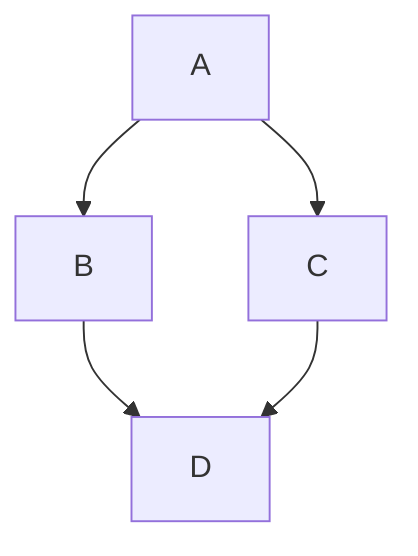
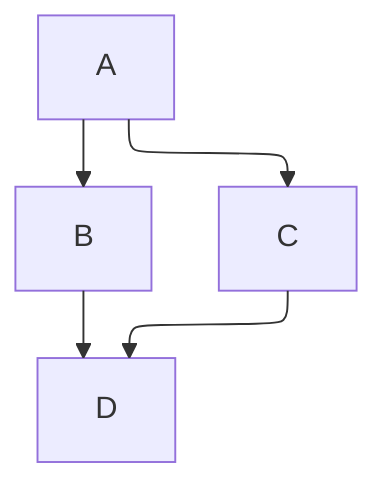

import BrowserWindow from '@site/src/components/BrowserWindow';

# Diagrammes

Les diagrammes peuvent être affichés en utilisant [Mermaid](https://mermaid-js.github.io/mermaid/) dans un bloc de code.

## Installation {/* #installation */}

```bash npm2yarn
npm install --save @docusaurus/theme-mermaid
```

Activez la fonctionnalité Mermaid en ajoutant le plugin `@docusaurus/theme-mermaid` et en définissant `markdown.mermaid` à `true` dans votre `docusaurus.config.js`.

```js title="docusaurus.config.js"
export default {
  markdown: {
    mermaid: true,
  },
  themes: ['@docusaurus/theme-mermaid'],
};
```

## Utilisation {/* #usage */}

Ajoutez un bloc de code avec le langage `mermaid` :

````md title="Example Mermaid diagram"

````

<BrowserWindow>


</BrowserWindow>

Voir la [documentation de la syntaxe de Mermaid ](https://mermaid-js.github.io/mermaid/#/./n00b-syntaxReference) pour plus d'informations sur la syntaxe de Mermaid.

## Thème {/* #theming */}

Les thèmes sombres et clairs du diagramme peuvent être modifiés en définissant les valeurs `mermaid.theme` dans le `themeConfig` de votre `docusaurus.config.js`. Vous pouvez définir des thèmes pour le mode clair et sombre.

```js title="docusaurus.config.js"
export default {
  themeConfig: {
    mermaid: {
      theme: {light: 'neutral', dark: 'forest'},
    },
  },
};
```

Voir la [documentation du thème de Mermaid ](https://mermaid-js.github.io/mermaid/#/theming) pour plus d'informations sur le thème de Mermaid.

## Configuration de Mermaid {/* #configuration */}

Les options dans `mermaid.options` seront passées directement à `mermaid.initialize` :

```js title="docusaurus.config.js"
export default {
  themeConfig: {
    mermaid: {
      options: {
        maxTextSize: 50,
      },
    },
  },
};
```

Consultez la [documentation de configuration Mermaid](https://mermaid-js.github.io/mermaid/#/./Setup?id=configuration) et les [types de configuration Mermaid(https://github.com/mermaid-js/mermaid/blob/master/packages/mermaid/src/config.type.ts) pour connaître les options de configuration disponibles.

## Composant Mermaid dynamique {/* #component */}

Pour générer des diagrammes dynamiques, vous pouvez utiliser le composant `Mermaid` :

```mdx title="Example of dynamic Mermaid component"
import Mermaid from '@theme/Mermaid';

<Mermaid
  value={`graph TD;
    A-->B;
    A-->C;
    B-->D;
    C-->D;`}
/>
```

## Layouts {/* #layouts */}

Mermaid supports different [layout engines](https://mermaid.js.org/intro/syntax-reference.html#layout-and-look):

- The `elk` layout engine is bundled and used by default for supported diagram types.
- The `dagre` layout engine is also bundled and can be selected explicitly.

### Site-wide layout {/* #site-wide-layout */}

To use Dagre across your site, set `themeConfig.mermaid.options.layout`:

```js title="docusaurus.config.js"
export default {
  themeConfig: {
    mermaid: {
      options: {
        layout: 'dagre',
      },
    },
  },
};
```

### Per-diagram layout {/* #per-diagram-layout */}

To use Dagre for a single diagram, set `layout: dagre` in its Mermaid front matter. This overrides the site-wide layout. Use `layout: elk` to select ELK explicitly.

````md

````

The same diagram rendered with each layout:

<div className="row">
<div className="col col--6">

**ELK (default)**

<BrowserWindow>



</BrowserWindow>

</div>
<div className="col col--6">

**Dagre**

<BrowserWindow>


</BrowserWindow>

</div>
</div>
