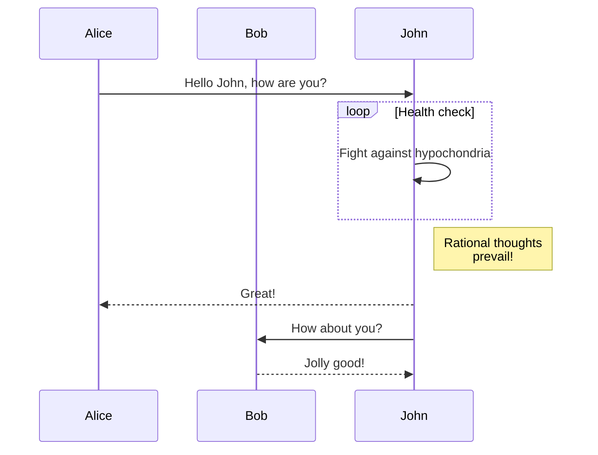

We are happy to announce **Docusaurus 2.2**.

업그레이드 과정은 간단합니다. 도큐사우루스는 [릴리스 프로세스 문서](/community/release-process)에 설명된 대로 [시맨틱 버전 체계](https://semver.org/)를 준수해 마이너 버전은 하위 호환성을 유지합니다.


{/* truncate */}

## 새로 추가된 기능 {/* #highlights */}

### 머메이드 다이어그램 {/* #mermaid-diagrams */}

In [#7490](https://github.com/facebook/docusaurus/pull/7490), we added support for Mermaid diagrams. This fills the gap between GitHub Flavored Markdown which also [added support recently](https://github.blog/2022-02-14-include-diagrams-markdown-files-mermaid/). 이제 여러분은 마크다운 코드 블록을 사용해 머메이드 다이어그램을 작성할 수 있습니다.

````md

````

````mdx-code-block
import BrowserWindow from '@site/src/components/BrowserWindow';

<BrowserWindow>


</BrowserWindow>

````

Make sure to check the [documentation](/docs/markdown-features/diagrams), and the [more advanced examples](/tests/pages/diagrams)

### Config `headTags` {/* #config-headtags */}

In [#8151](https://github.com/facebook/docusaurus/pull/8151), we added the ability to apply arbitrary HTML `<head>` tags to all pages of your site.

```js title="docusaurus.config.js"
module.exports = {
  headTags: [
    {
      tagName: 'link',
      attributes: {
        rel: 'icon',
        href: '/img/docusaurus.png',
      },
    },
  ],
};
```

### 접근성 {/* #accessibility */}

접근성 관련 몇 가지 기능을 개선했습니다.

- [#8207](https://github.com/facebook/docusaurus/pull/8207): improves keyboard navigation for mobile drawer hamburger button
- [#8161](https://github.com/facebook/docusaurus/pull/8161): improves keyboard navigation for tabs
- [#8204](https://github.com/facebook/docusaurus/pull/8204): makes the skip to content button support progressive enhancement
- [#8174](https://github.com/facebook/docusaurus/pull/8174): improves screen reader announcement when toggling between light/dark mode

### 개발자 경험 {/* #developer-experience */}

유효성 검사를 더 엄격하게 만들고 오류 메시지를 개선했습니다.

- [#8234](https://github.com/facebook/docusaurus/pull/8234): in case of doc processing failure, prints the problematic markdown file path in the error message
- [#8192](https://github.com/facebook/docusaurus/pull/8192) and [#8159](https://github.com/facebook/docusaurus/pull/8159): validates `siteConfig.url` more strictly and with better error message
- [#8066](https://github.com/facebook/docusaurus/pull/8066): makes config `url` and `baseUrl` fail-safe and less sensitive to the presence or absence of a leading or trailing slash

### 번역 {/* #translations */}

여러 언어에 대한 기본 테마 번역을 완료했습니다.

- 🇹🇷 [#8105](https://github.com/facebook/docusaurus/pull/8105): completes Turkish translations
- 🇷🇺 [#8253](https://github.com/facebook/docusaurus/pull/8253): completes Russian translations
- 🇫🇷 [#8243](https://github.com/facebook/docusaurus/pull/8243): completes French translations
- 🇯🇵 [#8075](https://github.com/facebook/docusaurus/pull/8075): completes Japanese translations

:::tip

테마 번역의 완료는 [계속 관심이 필요한 요소](https://github.com/facebook/docusaurus/issues/3526)이며 도큐사우루스에 기여할 수 있는 쉬운 방법입니다. 새로운 테마 기능을 계속 추가하고 있으며 이에 따라 [새로운 번역이 필요한 경우가 많습니다](https://github.com/facebook/docusaurus/issues/3526).

:::

## 기타 변경 {/* #other-changes */}

기타 주목할만한 변경 사항은 다음과 같습니다.

- [#8210](https://github.com/facebook/docusaurus/pull/8210): the `docusaurus swizzle` CLI has a new `--config` option
- [#8109](https://github.com/facebook/docusaurus/pull/8109): mobile navigation performance optimizations, prefetch resources earlier
- [#8059](https://github.com/facebook/docusaurus/pull/8059): versions/locales navbar dropdowns preserve hash and querystring on navigation
- [#8227](https://github.com/facebook/docusaurus/pull/8227): the client redirect plugin preserves hash and querystring on redirect

Check the **[2.2.0 changelog entry](/changelog/2.2.0)** for an exhaustive list of changes.
